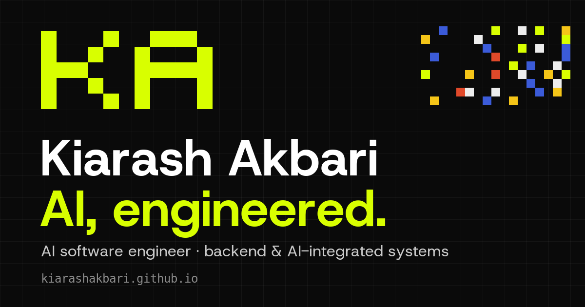

# // KIARASH_AKBARI(1)_PORTFOLIO


```text
SYSTEM_STATUS:    OPERATIONAL
ENTRY_POINT:      index.html (ONE FILE, ~188 KB)
LANGUAGES:        ENGLISH (LTR) + PERSIAN (RTL)
THEMES:           LIGHT / DARK / FOLLOW-SYSTEM
BACKEND:          NONE (CONTACT FORM VIA FORMSUBMIT RELAY)
THIRD_PARTY_LOAD: NONE — FONTS SELF-HOSTED, NO ANALYTICS
```

**[ LIVE_SYSTEM ]** → **https://kiarashakbari.github.io** ·
[PERSIAN_VERSION](https://kiarashakbari.github.io/?lang=fa)



---

## // 01_SYSTEM_OVERVIEW

**KIARASH_AKBARI(1)** is the personal portfolio of an AI software engineer
working on backend and AI-integrated systems. It ships as a single static page:
markup, CSS, JavaScript, both language dictionaries and the Latin font live in
`index.html`. No framework. No bundler. No `node_modules`. Push to `main` and it
is live.

The visual identity is a pixel grid. A page-wide canvas field reacts to scroll
and cursor, project tiles carry their own live canvas visualisations, and
interface chrome moves in sprite-style steps instead of floaty easing.

### [ CORE_CAPABILITIES ]

> **PIXEL FIELD:** A document-anchored canvas background that follows scroll and
> cursor, drawn with `image-rendering: pixelated` so squares stay hard-edged on
> 3x phone screens.
>
> **BILINGUAL BY CONSTRUCTION:** English and Persian share one markup tree,
> keyed through `data-i18n`. RTL layout, Arabic-script fonts and Persian numerals
> (`faNum`) are first-class, not an afterthought.
>
> **NATIVE-FEELING SCROLL:** Desktop wheel input eases the real `window` scroll
> position. Touch, keyboard, scrollbar drag, find-in-page and pinch-zoom are
> never intercepted.
>
> **RENDER INTEGRITY:** A guard layer stops dark-mode and style-injector
> extensions from recolouring the page, while leaving accessibility styles alone.
>
> **LIGHTWEIGHT MODE:** On coarse, small-screen or Save-Data devices, decorative
> canvases idle at 30 FPS and pause while scrolling.
>
> **CONTACT THAT DEGRADES GRACEFULLY:** The form works with JavaScript (in-page
> status line) and without it (plain HTML POST).
>
> **ACCESSIBILITY-AWARE:** Respects `prefers-reduced-motion`, `prefers-contrast`
> and forced colors. Touch targets are at least 44 px.

### [ THE_NUMBERS ]

| METRIC | VALUE |
| --- | --- |
| Runtime dependencies | **0** |
| Build / install steps | **0** |
| Backend services you run | **0** |
| Analytics / trackers | **0** |
| Third-party requests on page load | **0** |
| Main document | **1 file, ~188 KB** |
| Monthly hosting cost | **$0** |

---

## // 02_ARCHITECTURE_PIPELINE

Order inside `index.html` is load-bearing.

```text
[ BROWSER_TAB ]
       |
       v
[ PRE-PAINT SCRIPT ] ......... resolves theme + language BEFORE first paint
       |                       priority: localStorage -> URL (?lang, #fa)
       |                                 -> prefers-color-scheme / browser lang
       v
[ <style data-ka> ] .......... layout + components + @font-face
       |
       v
[ <style id="ka-hard"> ] ..... HARDENED PALETTE (only home of colour tokens)
       |
       v
[ RENDER GUARD <script> ] .... neutralises extension-injected styles
       |
       v
[ BODY SECTIONS ]
       |-- #sitehead   fixed header, hidden until the masthead scrolls past
       |-- #hero       name -> pixel field -> intro rhythm
       |-- #work       project carousel (canvas vizzes: bim | nids | clone | vino)
       |-- #about  #focus  #process (#flow)  #stack  #experience
       |-- #contact    #sendbox form
       └-- footer      skyline canvas + #tetris easter egg
       |
       v
[ MAIN SCRIPT ] .............. builds window.KA
       |-- theme reader, event bus (KA.on / KA.emit), helpers
       └-- IIFE modules: i18n | theme+lang panel | scroll glide + header
                         | #field canvas | reveals | carousel | vizzes | form
```

### [ INVARIANTS ]

| RULE | WHY IT EXISTS |
| --- | --- |
| Colour tokens are declared **only** in `#ka-hard` | It outranks extension sheets with phantom-id specificity. Editing `:root` silently does nothing. |
| Every added `<style>` / `<script>` carries `data-ka` | The guard disables any unmarked sheet as foreign. |
| Every visible string exists in both EN and FA | English-only copy leaves the Persian page wrong. |
| Scroll stays on the real `window` position | Canvases and observers read `scrollY`; a transformed body would desync them. |
| No `backdrop-filter` on the fixed header | Blurring a full-screen animated canvas every frame costs scroll performance. |
| No universal-selector rule during scroll | It forces a full-document style recalc exactly when a phone is busiest. |
| The pixel field never drops to 30 FPS | At half rate the trail and sprites visibly stutter on phones. |
| Field bitmap sized to the large viewport | Sliding browser chrome would otherwise stretch the art mid-scroll. |
| No third-party requests on load | Privacy blockers and filtered networks must have nothing to cancel. |

---

## // 03_QUICKSTART

### [ MODE_A: JUST_VISIT_IT ]

Open **https://kiarashakbari.github.io**. Append `?lang=fa` for Persian.

### [ MODE_B: RUN_IT_LOCALLY ]

```bash
git clone https://github.com/KiarashAkbari/KiarashAkbari.github.io.git
cd KiarashAkbari.github.io
python3 -m http.server 8000
# open http://localhost:8000   (or http://localhost:8000/?lang=fa)
```

There is nothing to install, build, compile or transpile.

### [ MODE_C: DEPLOY_YOUR_OWN ]

```bash
# GitHub Pages: repo named <user>.github.io, branch main, folder /(root)
# Keep the .nojekyll file so Pages serves the folder verbatim.
```

### [ URL_FLAGS ]

| FLAG | EFFECT |
| --- | --- |
| `?lang=fa` / `?lang=en` | Force language |
| `?scroll=native` | Disable the desktop scroll glide for this load |
| `?ext=keep` | Let a style extension restyle the page (remembered in `ka-ext`) |
| `?ext=deep` | Also strip Dark Reader's per-element inline overrides |
| `?ext=block` | Force the render guard back on |

### [ CONSOLE_TOOLS ]

```js
KA.guard.stats()   // guard activity
KA.guard.off()     // pause the guard
KA.guard.reset()   // re-arm it
KA.glideTo(y)      // eased programmatic scroll
KA.quickScrollTo(y)
```

---

## // 04_OPERATIONAL_MANUAL

### [ NAVIGATION_&_SCROLL ]

The hero name block is the masthead, so the fixed header stays hidden until it
has scrolled past. After that the header hides on a deliberate scroll down and
returns on scroll up, on keyboard focus, or when the cursor reaches the top
edge. Its links mark the section in view.

Wheel scrolling updates a target and the real scroll position eases toward it
(about a 92 ms time constant). It is off for coarse pointers and
`prefers-reduced-motion`. Anchors clear the header through `scroll-margin-top`.

### [ MOTION_LANGUAGE ]

* **Chrome moves in steps.** Header slide, settings panel, pips and hover CTAs
  use `steps(n)`, like a sprite animation.
* **Text reveals are eased.** Hero lines, the lead reveal and `.reveal` use
  `cubic-bezier(.16,1,.3,1)`. The stepped version read as lag, not style.

### [ MOBILE_&_LIGHT_MODE ]

Safe-area padding (`env(safe-area-inset-*)`), consistent gutters, an
overflow-proof header from 320 to 680 px, and debounced width-based resize
handling (`KA.onResize`) that ignores address-bar jitter. In light mode the
carousel edge fade is a pair of gradient overlays rather than a CSS mask, and GPU
layer promotion happens only during active gestures.

### [ CONTACT_FORM ]

`#sendbox` posts to [FormSubmit](https://formsubmit.co), which forwards to the
address already printed on the page.

| PATH | BEHAVIOUR |
| --- | --- |
| JavaScript on | JSON POST to `/ajax/`, visitor stays on the page, polite `role="status"` line. On failure it falls back to `form.submit()`. |
| JavaScript off | Real `action` + `method="POST"`; lands on `_next`, rewritten to `location.href`. |

Spam is handled by a `_honey` honeypot (hidden with `.sr`, not `display:none`)
and `_captcha:false`. The **first** submission needs a one-time activation click
from the relay's email. Swapping providers is one attribute: Web3Forms uses
`https://api.web3forms.com/submit` plus a hidden `access_key`; Formspree uses
`https://formspree.io/f/ID`.

### [ RENDER_GUARD ]

Style-injector extensions append their own `<style>`, hang filters on `<html>`
and patch the canvas 2D context to recolour `fillStyle`. The guard keeps their
sheets out of the cascade, strips inline root filters, restores native canvas
methods, and re-arms itself if a sheet comes back. After twelve fights it removes
the sheet; a storm parks the guard instead of spinning.

Deliberately **not** fought: user-origin `!important` styles, forced colors,
font-size substitutions for reading support, and extension UI in shadow roots.
That is accessibility, on purpose.

---

## // 05_FILE_STRUCTURE

```text
/ROOT
├── index.html      # [KERNEL]  Markup, CSS, JS, i18n dictionaries, inlined Latin font
├── 404.html        # [FALLBACK] Branded standalone not-found page (root-absolute paths)
├── assets/
│   ├── og.png                       # 1200x630 Open Graph / Twitter image
│   └── Kiarash_Akbari_Resume_TE.pdf # Resume download target
├── fonts/
│   ├── Lahzeh-*.ttf        # Persian/Arabic-script faces (100-900), owner-supplied
│   ├── Lahzeh-NOTICE.md    # READ BEFORE REUSE
│   ├── Vazirmatn-arabic.woff2   # Arabic-script fallback
│   └── HostGrotesk-latin.woff2  # Source copy of the inlined Latin face
├── .nojekyll       # Makes Pages serve the folder verbatim. Keep it.
├── AGENTS.md       # Contributor + AI-agent contract (read before editing)
└── README.md       # This document
```

Font stack: `--sans` is Host Grotesk -> Lahzeh -> Vazirmatn. Arabic-script
`unicode-range` keeps Latin text and ASCII digits on Host Grotesk.

---

## // 06_DEPLOYMENT_PROTOCOL

GitHub Pages deploys `main` from the repository root.

**Pushing to `main` is deploying. There is no staging.**

* Pages normally publishes in under a minute. A push that fails to trigger a
  build silently keeps serving the old version, so check *Settings -> Pages*
  after structural changes.
* GitHub Pages ignores `_headers`; there is no cache-header lever, and none is
  needed for a small static page.
* **Why `github.io`:** it keeps resolving for the audience the page is written
  for, while Cloudflare's free hostnames (`*.pages.dev`, `*.workers.dev`) are
  filtered in Iran as a class. Keeping Cloudflare out of the request path avoids
  inheriting IP-range blocking when filtering tightens.
* **Custom domain:** edit `<link rel="canonical">` and `og:url` in `<head>`, set
  the domain in Settings -> Pages, then point an apex `ALIAS` record and a `www`
  `CNAME` at `KiarashAkbari.github.io`. GitHub issues the certificate.

### [ VERIFY_A_CHANGE ]

There is no test suite. Serve locally, then check:

- [ ] Light and dark theme, including fresh loads under each OS setting
- [ ] English LTR and Persian RTL (`?lang=fa`), numerals included
- [ ] Narrow mobile viewport: carousel, settings panel, Tetris teaser
- [ ] Trackpad glide, header hide/show, native scrollbar/keyboard/touch/zoom
- [ ] `prefers-reduced-motion` calms canvases and disables the glide
- [ ] JavaScript disabled: content visible, form still submittable
- [ ] Console clean, `KA.guard.stats()` sane, no new requests on load

---

## // 07_DESIGN_CONSTRAINTS

Ground rules for anyone (or anything) sending a patch. Full detail lives in
[`AGENTS.md`](AGENTS.md).

| CONSTRAINT | RATIONALE |
| --- | --- |
| **No npm, no framework, no bundler, no CDN** | The repository *is* the deployment. |
| **No third-party fonts, scripts or analytics** | Self-hosting is the privacy and reachability promise. |
| **Keep both contact-form paths and the honeypot** | JS-off visitors must still be able to write. |
| **Keep the Persian font order and ranges** | Prevents Latin text from rendering in Arabic-script faces. |
| **Never move text reveals back to `steps(n)`** | Owner decision after testing on phones. |

---

## // 08_PRIVACY_LEDGER

```text
>> DATA_AT_REST:        THEME + LANGUAGE + FORM NAME/EMAIL IN YOUR BROWSER (localStorage)
>> DATA_SENT_ON_LOAD:   NONE
>> DATA_SENT_ON_SUBMIT: FORM FIELDS -> FORMSUBMIT RELAY -> SITE OWNER'S INBOX
>> ANALYTICS:           NONE
>> COOKIES:             NONE SET BY THIS PAGE
>> FONTS:               SELF-HOSTED
```

---

## // 09_ENGINEER_INFO

```text
LEAD_ENGINEER:    KIARASH AKBARI
PROJECT:          KIARASH_AKBARI(1) // PORTFOLIO
STACK:            HTML + CSS + JS + CANVAS 2D. THAT IS THE COMPLETE LIST.
LIVE:             kiarashakbari.github.io
SOURCE:           github.com/KiarashAkbari/KiarashAkbari.github.io
```

---

## // 10_LICENSE_AND_NOTICES

```text
>> CODE & CONTENT:      (c) KIARASH AKBARI. ALL RIGHTS RESERVED UNLESS STATED OTHERWISE
>> LAHZEH FONTS:        OWNER-SUPPLIED, NOT OPEN-SOURCE (SEE fonts/Lahzeh-NOTICE.md)
>> VAZIRMATN / HOST GROTESK: OPEN-SOURCE FACES
```

**[ NOTICE ]**

1. **Fonts.** Do not convert, subset, replace or redistribute the Lahzeh files
   without reading `fonts/Lahzeh-NOTICE.md`.
2. **Reuse.** Ideas and techniques described here are free to learn from;
   please do not republish the page as your own.

*System Halt.*
